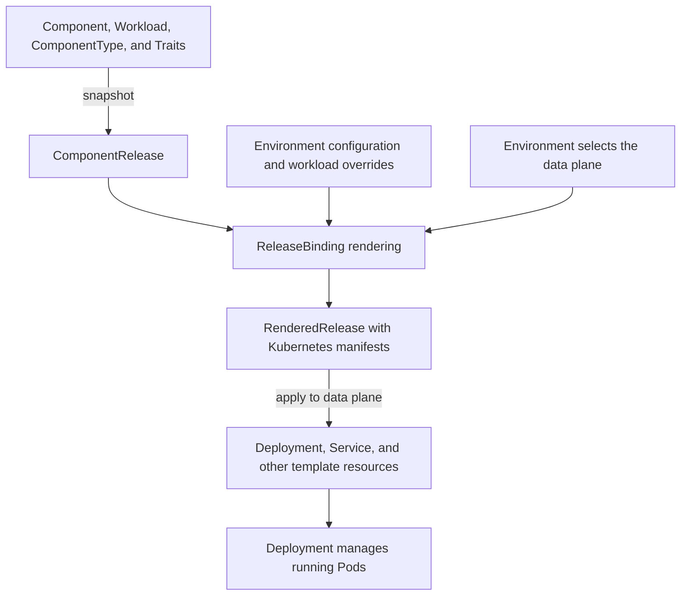

# Runtime Model

The runtime model describes how OpenChoreo's abstractions transform into running systems. When developers declare
projects and components, the platform orchestrates a sophisticated runtime environment that provides isolation,
security, and observability. Understanding this transformation from declaration to execution helps teams design better
applications and troubleshoot issues effectively.

## Cell Architecture

At runtime, each **Project** transforms into a **Cell** - a secure, isolated runtime boundary that encapsulates all
components of an application domain. This transformation represents a fundamental principle of OpenChoreo:
organizational boundaries in code become physical boundaries in infrastructure.

Cells provide complete isolation between different application domains. Each cell operates as an independent unit with
its own namespace, network policies, and security boundaries. Components within a cell can communicate freely using
cluster-local networking, but all communication across cell boundaries must flow through well-defined gateways. This
architecture ensures that failures, security breaches, or performance issues in one cell cannot directly impact others.

The cell's namespace and its baseline resources have an explicit owner: the **ProjectReleaseBinding** for that project
and environment. The binding renders the project's ProjectType (which must declare the namespace itself as a template
entry), creates the namespace on the data plane, and seeds it with the shared infrastructure the type defines, such as
default-deny network policies and resource quotas. Component and resource deployments into the environment wait for
this namespace to exist, so the cell's boundary is established before anything runs inside it, and its lifecycle is
tied to the project and environment rather than to whichever component deployed first.

The cell model aligns with microservices best practices and Domain-Driven Design principles. By mapping bounded contexts
to isolated runtime units, OpenChoreo ensures that architectural boundaries are enforced by infrastructure. This
alignment reduces the cognitive load on developers - the same mental model used for designing applications applies to
their runtime behavior.

## Traffic Flow Patterns

OpenChoreo implements a structured approach to network traffic through directional gateways, each serving a specific
purpose in the overall communication architecture. These patterns provide clarity about how data flows through the
system while enabling sophisticated security and routing policies.

### Northbound Ingress

Northbound ingress handles traffic entering cells from the public internet. This gateway serves as the entry point for
external users, customers, and third-party integrations accessing public APIs and web applications. The platform
automatically configures load balancing and TLS termination at this boundary.

The northbound gateway translates friendly DNS names into internal service endpoints, handles HTTP routing based on
hostnames and paths, and enforces public-facing API policies. This abstraction means developers can focus on application
logic while the platform manages the complexities of internet-facing services.

### Southbound Egress

Southbound egress manages traffic leaving cells to reach external services on the internet. This gateway provides
controlled access to third-party APIs, cloud services, and external databases. By channeling all outbound traffic
through a managed gateway, the platform can enforce security policies, manage credentials, and provide observability for
external dependencies.

The southbound gateway enables capabilities like egress filtering to prevent data exfiltration, credential injection for
authenticated external services, and circuit breaking for unreliable external dependencies. This controlled approach to
external communication reduces security risks while improving reliability.

### Westbound Ingress

Westbound ingress handles traffic from other parts of the organization entering the cell. This gateway manages internal
API consumption, service-to-service communication across projects, and administrative access. Unlike public northbound
traffic, westbound traffic comes from trusted sources within the organization but still requires authentication and
authorization.

The westbound gateway enables internal service discovery, allowing components in other cells to locate and communicate
with services using logical names. It enforces organization-wide policies while allowing more permissive communication
than public interfaces. This balance enables productive development while maintaining security boundaries.

### Eastbound Egress

Eastbound egress manages traffic leaving the cell to reach other cells or internal services within the organization.
This gateway handles inter-project dependencies, shared service consumption, and platform service integration. By
managing internal outbound traffic, the platform can track dependencies, enforce quotas, and provide circuit breaking
between internal services.

The eastbound gateway makes internal service dependencies explicit and observable. Teams can understand which other
projects they depend on, platform engineers can track usage patterns across the organization, and the system can prevent
cascading failures through circuit breaking and retry policies.

## Network Security

OpenChoreo manages network security through the cell architecture and gateway pattern. Communication within a cell is
allowed between components of the same project, while all cross-cell communication must flow through the defined
gateways. This provides security boundaries between different application domains.

The platform uses Cilium for network policy enforcement and kgateway for ingress traffic management. Developers
declare their components' endpoints and dependencies in the workload specification, and the platform handles the
underlying network configuration.

## Workload Execution

When components deploy to a runtime environment, OpenChoreo orchestrates a complex series of transformations. The
abstract component definition combines with workload specifications, environment configurations, and platform policies
to produce concrete Kubernetes resources.

The platform manages the complete lifecycle of these resources. It creates deployments with appropriate resource limits
and scaling parameters, configures services for network access and load balancing, injects configuration and secrets
from secure stores, and establishes health checks and readiness probes. This orchestration happens transparently -
developers see their components running while the platform manages the underlying complexity.

Workload execution is environment-aware. The same component might run with different resource allocations, replica
counts, or configuration values in different environments. The platform manages these variations through the binding
system, where environment-specific bindings override default values from ComponentTypes, Traits, and workload specifications.

Resources follow the same render-and-apply path. Each ResourceReleaseBinding renders its ResourceType template with
the combined Resource parameters and environment overrides, produces a RenderedRelease, and applies the resulting
manifests to the data plane. The provisioned outputs are resolved back to the binding so consuming components can read
them at pod-start. The render gate on the consuming Component waits for its declared Resource dependencies to be
Ready before producing its own RenderedRelease, so a component is not deployed until the infrastructure it depends on
is healthy.

### From Application Configuration to Running Containers

For a service component, the deployment path below shows how configuration becomes Kubernetes objects on the data
plane. This diagram covers only data-plane resources. Traits can also render resources to the observability plane
using [`targetPlane: observabilityplane`](../reference/api/platform/trait.md#traitcreate); those resources are not shown.
The exact objects depend on the ComponentType and Traits captured in the release.

A ComponentRelease preserves the application inputs, while a RenderedRelease contains the result of rendering those
inputs for a binding's target environment. Reusing a ComponentRelease across environments preserves the release
snapshot; environment overrides and resolved dependencies can still produce different manifests.

For example, after a new catalog image is built, the Workload can reference that image and a new ComponentRelease can
capture it. Updating the development ReleaseBinding to the new release deploys it there. Production continues to use
its existing release until its binding is advanced. With `autoDeploy` enabled, OpenChoreo handles deployment to the
pipeline's first environment automatically; see [Deploy and Promote](../developer-guide/deploying-applications/deploy-and-promote.md).

When troubleshooting, follow the same path: check the binding's selected release and environment, then inspect the
RenderedRelease and the resulting Kubernetes objects. A successful image build alone does not mean the application is
running. See [Logs and Troubleshooting](../developer-guide/deploying-applications/logs-and-troubleshooting.md) and the
[RenderedRelease API reference](../reference/api/runtime/renderedrelease.md).

## Service Discovery and Load Balancing

Service discovery uses standard Kubernetes DNS, allowing services to communicate using service names. Within a cell,
components can discover each other using simple service names. Across cells, services require routing through the
appropriate gateways.

## Observability

The runtime model includes centralized logs, metrics, and traces collected through the Observability Plane. Logs from all containers flow through the platform's collection pipeline configured in the Observability Plane, enriched with metadata about the source component, project, and environment. This enrichment enables queries across the entire platform while maintaining clear attribution of log entries to their sources.

The Observer API provides access to these logs, metrics, and traces, allowing developers to search and analyze application behavior across environments. This centralized observability approach ensures that debugging information is always available without requiring additional configuration from developers.

The platform also provides a centralized alerting and RCA (Root Cause Analysis) system through the Observability Plane. Developers can define alert rules in their components' traits, and the platform will automatically create alert rules in the Observability Plane. When an alert fires, incident creation and AI RCA can be triggered if they are enabled for that rule.
