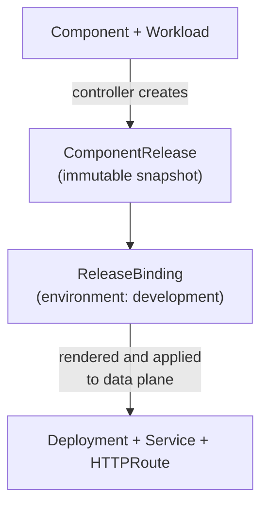

import CodeBlock from "@theme/CodeBlock";
import { versions } from "../_constants.mdx";

# Deploy and Explore

This guide walks you through deploying a component on OpenChoreo and exploring what the platform creates behind the scenes. By the end, you'll understand the full resource chain, from the Component you define to the Kubernetes Deployment running your code.

This guide contains steps to deploy an OpenChoreo sample service or to deploy from your own codebase.

:::tip Already deployed via Quick Start?
If you followed the [Quick Start Guide](./quick-start-guide.mdx), you've already deployed a sample app. This page revisits the process step by step so you can understand what each resource does.
:::

## Prerequisites

- **OpenChoreo installed** on your cluster (see [Local Setup](./try-it-out/on-k3d-locally.mdx) or [Your Own Cluster](./try-it-out/on-your-environment.mdx))
- **kubectl** configured and pointing at your cluster

## Deploy the Sample

We'll deploy the Go Greeter Service from a pre-built container image. The sample YAML contains two key resources:

- **Component**: declares the application, referencing the `deployment/service` ClusterComponentType
- **Workload**: specifies the container image, ports, environment variables, and an external endpoint

<CodeBlock language="bash">
  {`kubectl apply -f https://raw.githubusercontent.com/openchoreo/openchoreo/${versions.githubRef}/samples/from-image/go-greeter-service/greeter-service.yaml`}
</CodeBlock>

Wait for the deployment to be ready:

```bash
kubectl wait --for=condition=Ready component/greeter-service -n default --timeout=120s
```

Skip ahead to [Explore What OpenChoreo Created](#explore-what-openchoreo-created), or read on to deploy your own code instead.

## Deploy Your Own Codebase

If you already have your own codebase, you can follow the steps below to deploy it in OpenChoreo. There are two routes to follow.

1. If you only have the source code, you can build and deploy it by following [Route A](#route-a-build-from-source).
2. If you already have a container image, you can deploy it by following [Route B](#route-b-deploy-an-image-you-already-built).

Whichever route you take, OpenChoreo needs two things:

- a **Component**, declaring which ComponentType to deploy with and where your code or image lives
- a **Workload**, declaring how your container runs: image, endpoints, environment variables, files, and dependencies

The way the Workload gets created differs based on the route you take.

| Where your image comes from        | What you author                                                                  | How the Workload is created |
| ---------------------------------- | -------------------------------------------------------------------------------- | --------------------------- |
| OpenChoreo builds your source code | A Component with `spec.workflow`, plus a `workload.yaml` file in your repository | The build generates it      |
| You already have a container image | A `Component` and a `Workload` resource                                          | You write it                |

### Route A: Build from Source

#### Prerequisites

- A **Workflow Plane**, which the quick start does not install by default. Add `--with-build` to the installer, then confirm it is there:

  ```bash
  occ clusterworkflowplane list
  occ clusterworkflow list
  ```

  The second command lists the build workflows you can reference, such as `dockerfile-builder` and `paketo-buildpacks-builder`.

- A **public Git repository** containing your application. For private repositories, see [Private Repository Access](../developer-guide/workflows/ci/private-repository.md).

#### 1. Describe your runtime

Commit a [workload Descriptor](../developer-guide/workload/descriptor.md) at the root of your application directory (the path you will set as `repository.appPath`) to declare what your service exposes:

```yaml
apiVersion: openchoreo.dev/v1alpha1

metadata:
  name: my-service-workload

endpoints:
  - name: http
    type: HTTP
    port: 8080
    visibility:
      - external

configurations:
  env:
    - name: LOG_LEVEL
      value: info
```

Set `port` to the port your application actually listens on, and keep `external` only if you want the endpoint reachable through the public gateway. Environment variables, mounted files, and dependencies on other components or on databases all go in this file. Refer [Workload Descriptor](../developer-guide/workload/descriptor.md) for more details.

#### 2. Create the Component

The Component points at your repository and names the build workflow to run:

```yaml
# my-service.yaml
apiVersion: openchoreo.dev/v1alpha1
kind: Component
metadata:
  name: my-service
  namespace: default
spec:
  owner:
    projectName: default
  componentType:
    kind: ClusterComponentType
    name: deployment/service
  autoDeploy: true
  workflow:
    kind: ClusterWorkflow
    name: dockerfile-builder
    parameters:
      repository:
        url: "https://github.com/my-org/my-service"
        revision:
          branch: "main"
        appPath: "/"
      docker:
        context: "."
        filePath: "./Dockerfile"
```

```bash
occ apply -f my-service.yaml
```

`autoDeploy: true` deploys the result as soon as a build succeeds in the next step.

#### 3. Trigger a build

```bash
occ component workflow run my-service
```

If you haven't installed the CLI, create the WorkflowRun yourself. The two labels are what link the build to your Component, and the workflow must match the one on the Component:

```yaml
# my-service-build-01.yaml
apiVersion: openchoreo.dev/v1alpha1
kind: WorkflowRun
metadata:
  name: my-service-build-01
  namespace: default
  labels:
    openchoreo.dev/project: "default"
    openchoreo.dev/component: "my-service"
spec:
  workflow:
    kind: ClusterWorkflow
    name: dockerfile-builder
    parameters:
      repository:
        url: "https://github.com/my-org/my-service"
        revision:
          branch: "main"
        appPath: "/"
      docker:
        context: "."
        filePath: "./Dockerfile"
```

Save it to a file and create it:

```bash
kubectl apply -f my-service-build-01.yaml
```

Follow the build. `occ component workflow run` generates the WorkflowRun name and prints it, so substitute that name here:

```bash
occ workflowrun get <workflowrun-name> -n default
occ workflowrun logs <workflowrun-name> -f
```

If you created the WorkflowRun yourself, the name is the one you set in the manifest above. Either way, you can list the runs for your component by label:

```bash
kubectl get workflowrun -n default -l openchoreo.dev/component=my-service
```

`occ workflowrun logs` requires the CLI. Without it, follow progress through `status.tasks` on the run:

```bash
kubectl get workflowrun <workflowrun-name> -n default -o yaml
```

The run moves through `checkout-source`, the build step, `publish-image`, and finally `generate-workload-cr` — the step that turns your descriptor into a Workload.

#### 4. Check the Workload the build produced

```bash
occ workload list -n default
```

Confirm the image and endpoints are what you expected:

```bash
occ workload get my-service-workload -n default
```

Since we set `autoDeploy: true` earlier, the Workload should now be deploying. Continue at [Explore What OpenChoreo Created](#explore-what-openchoreo-created).

### Route B: Deploy an Image You Already Built

If your own CI already publishes images, skip the workflow entirely and write the Workload yourself:

```yaml
apiVersion: openchoreo.dev/v1alpha1
kind: Component
metadata:
  name: my-service
  namespace: default
spec:
  owner:
    projectName: default
  componentType:
    kind: ClusterComponentType
    name: deployment/service
  autoDeploy: true
---
apiVersion: openchoreo.dev/v1alpha1
kind: Workload
metadata:
  name: my-service-workload
  namespace: default
spec:
  owner:
    projectName: default
    componentName: my-service
  container:
    image: ghcr.io/my-org/my-service:v1.0.0
    env:
      - key: LOG_LEVEL
        value: info
  endpoints:
    http:
      type: HTTP
      port: 8080
      visibility:
        - external
```

Apply both resources together:

```bash
occ apply -f my-service.yaml
kubectl wait --for=condition=Ready component/my-service -n default --timeout=120s
```

Continue at [Explore What OpenChoreo Created](#explore-what-openchoreo-created).

## Explore What OpenChoreo Created

When you followed the steps above, OpenChoreo's controllers reconciled your Component and Workload into the same chain of resources. Let's walk through each one.

The commands in this section take the component name from a shell variable. Run only the line that matches the component you just deployed:

```bash
# The sample from "Deploy the Sample"
export COMPONENT=greeter-service

# Or your own, from "Deploy Your Own Codebase"
# export COMPONENT=my-service
```

### The Resource Chain



### 1. Component

The Component declares your application and links it to a platform-defined template (ClusterComponentType). With `autoDeploy: true`, OpenChoreo automatically creates a release and deploys it to the first environment in the deployment pipeline. Later environments in the pipeline are not deployed automatically; each one requires a promotion.

```bash
occ component get $COMPONENT -n default
```

Look at `status.latestRelease.name` in the output to see which ComponentRelease was created:

```text
status:
  latestRelease:
    name: greeter-service-5d7f658d9c
```

The suffix is a hash derived from the release spec, so your value will differ.

### 2. ComponentRelease

The ComponentRelease is an **immutable snapshot** that freezes the Component's configuration, including the ComponentType spec, Trait definitions, parameters, and Workload. This enables reliable rollbacks and audit trails.

```bash
occ componentrelease list --project default --component $COMPONENT -n default
```

The name includes a hash of the spec, so a new release is only created when something actually changes.

### 3. ReleaseBinding

The ReleaseBinding binds a ComponentRelease to a specific environment. It references the release name and the target environment (`development`). This is where environment-specific overrides (like replica counts or resource limits) can be applied.

```bash
occ releasebinding list --project default --component $COMPONENT -n default
```

The name follows the convention `{component}-{environment}`.

### 4. Underlying Kubernetes Resources

From the ReleaseBinding, OpenChoreo renders the final Kubernetes manifests and applies them to a data plane namespace:

- **Deployment**: manages the pod running your container image
- **Service**: provides stable networking for the pod
- **HTTPRoute**: configures the API gateway to route external traffic to your service, created for each endpoint with `external` visibility

```bash
kubectl get deployment,svc,httproute -A -l openchoreo.dev/component=$COMPONENT
```

Notice these resources live in a data plane namespace (e.g., `dp-default-default-development-*`), not in the `default` namespace where you created your Component. This separation is by design: the control plane manages intent while the data plane runs workloads.

## Test the Running Service

External endpoints are routed at `/{component}-{endpoint}`, so an endpoint named `http` is reachable at `/$COMPONENT-http`:

```bash
curl http://development-default.openchoreoapis.localhost:19080/$COMPONENT-http/
```

The sample's greeter serves `/greeter/greet` under that prefix:

```bash
curl http://development-default.openchoreoapis.localhost:19080/greeter-service-http/greeter/greet
```

```text
Hello, Stranger!
```

Try it with a name parameter:

```bash
curl "http://development-default.openchoreoapis.localhost:19080/greeter-service-http/greeter/greet?name=OpenChoreo"
```

```text
Hello, OpenChoreo!
```

The URL structure is: `http://{environment}-{namespace}.{gateway-host}/{component}-{endpoint}/{path}`

## Summary

However you supplied the Component and Workload, a sample, a build from your source, or an image you already had, OpenChoreo created the same deployment chain:

**Component** → **ComponentRelease** (immutable snapshot) → **ReleaseBinding** (binds to environment) → **Deployment + Service + HTTPRoute** (running on data plane)

To learn more about these abstractions, see [Resource Relationships](../concepts/resource-relationships.md) and [Runtime Model](../concepts/runtime-model.md).

## Clean Up

To remove the sample:

<CodeBlock language="bash">
  {`kubectl delete -f https://raw.githubusercontent.com/openchoreo/openchoreo/${versions.githubRef}/samples/from-image/go-greeter-service/greeter-service.yaml`}
</CodeBlock>

To remove your own component, delete the Component and workload. The ComponentRelease, ReleaseBinding, and the data plane resources are garbage collected with it:

```bash
occ component delete $COMPONENT -n default
occ workload delete $COMPONENT-workload -n default
```
