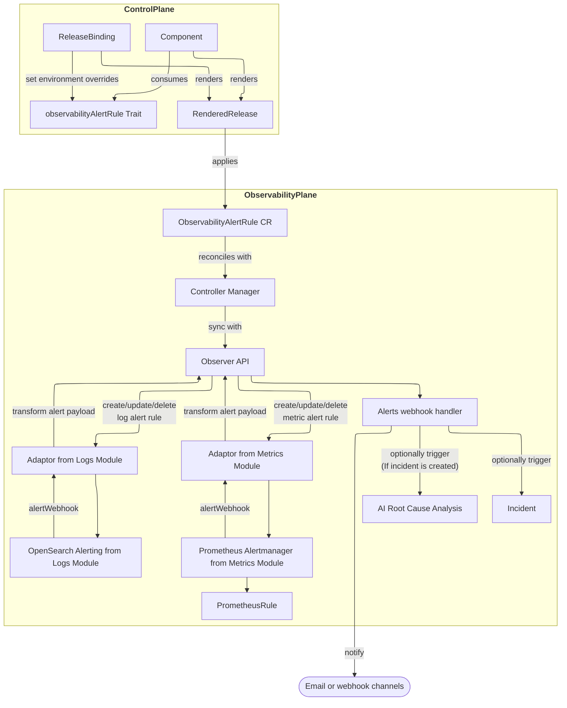

# Alerting

OpenChoreo provides a unified alerting experience based on logs and resource usage metrics.
Alert rules are defined as traits on components and are automatically created for each environment by the control plane during component releases.
Alert notifications are configured as notification channels and are sent through the configured channels when an alert is triggered.

## Alerting architecture

The following diagram shows the end-to-end alerting flow across planes:



## Alert Rule Configuration (Developers)

OpenChoreo ships a default trait named `observability-alert-rule` that can be used to define alert rules on components.
Platform engineers can define their own traits to provide platform-specific alert rules as required.

In your `Component` definition, attach alert rules as traits:

```yaml
traits:
  - name: observability-alert-rule
    kind: Trait
    instanceName: high-error-rate-log-alert
    parameters:
      description: "Triggered when error logs count exceeds 50 in 5 minutes."
      severity: "critical"
      source:
        type: "log"
        query: "status:error"
      condition:
        window: 5m
        interval: 1m
        operator: gt
        threshold: 50
```

This trait will create an `ObservabilityAlertRule` CR with `spec.source` and `spec.condition` set from the parameters, and an `actions` block that can be customized per environment.

## Environment-Specific Overrides (Platform Engineers)

Environment-specific parameters for the alert rule (such as enabling/disabling the rule, choosing notification channels, and toggling incident/AI root cause analysis) are configured in the `ReleaseBinding` CR via `traitEnvironmentConfigs`:

```yaml
spec:
  traitEnvironmentConfigs:
    high-error-rate-log-alert:
      enabled: true
      actions:
        notifications:
          channels:
            - devops-email-notifications
        incident:
          enabled: true
          triggerAiRca: false
```

This tells the control plane to:

- enable the alert rule in this environment,
- send notifications to the `devops-email-notifications` `ObservabilityAlertsNotificationChannel`, and
- create incidents (without AI RCA) when the rule fires.

## Alert Source Types

| Type     | Description           | Use Case                              |
| -------- | --------------------- | ------------------------------------- |
| `log`    | Log-based alerting    | Error patterns, specific log messages |
| `metric` | Metric-based alerting | Resource utilization (CPU, memory)    |

## Alert Condition Operators

| Operator | Description           |
| -------- | --------------------- |
| `gt`     | Greater than          |
| `lt`     | Less than             |
| `gte`    | Greater than or equal |
| `lte`    | Less than or equal    |
| `eq`     | Equal to              |

## Notification Channels

Alert notifications are sent through notification channels, configured per environment by platform engineers. See [Notification Channels](./notification-channels.mdx) for the channel types, their secret values and examples.

## AI-Powered Root Cause Analysis

When incident creation and AI RCA are enabled for an alert rule (via `actions.incident.enabled: true` and `actions.incident.triggerAiRca: true`), OpenChoreo's SRE Agent automatically analyzes the incident and generates a root cause analysis report.

Platform engineers configure the SRE Agent deployment via the observability plane Helm chart (`rca.*` values), and enable AI RCA for an alert rule through trait environment configs and `ReleaseBinding` overrides.

See [SRE Agent](../../ai/sre-agent.mdx) for configuration details.

## Viewing Alerts and Incidents

Once alert rules are in place and notifications are configured, OpenChoreo also persists alert events and incidents in the observability plane.
You can query them via the Observer API. This can be accessed via the Backstage portal or the OpenChoreo MCP server.
Observer handles the authentication and authorization based on OpenChoreo user identity.

For a full, end-to-end walkthrough of defining alert rules, configuring channels, and triggering alerts, refer to the [Component Alerts sample](https://github.com/openchoreo/openchoreo/tree/main/samples/component-alerts).

## Configuring Alert Storage

Alert entries and incidents are persisted in a storage backend. The Observer supports two backends: **SQLite** (default) and **PostgreSQL**.

### SQLite (Default)

By default, alert entries and incidents are stored in an SQLite database backed by a `ReadWriteOnce` PersistentVolumeClaim. This is the simplest option and requires no external database.

```yaml
observer:
  alertStoreBackend: sqlite # default
  alertStoreSqliteSize: 128Mi # PVC size for the SQLite database
  replicas: 1 # must be 1 with SQLite (ReadWriteOnce PVC)
  secretName: observer-secret # Secret with OPENSEARCH_USERNAME, OPENSEARCH_PASSWORD, UID_RESOLVER_OAUTH_CLIENT_SECRET
```

:::note
When using the SQLite backend, `observer.replicas` must be `1` because the PVC uses `ReadWriteOnce` access mode. Attempting to set a higher replica count will cause the Helm install to fail.
Also, the deployment strategy is set to `Recreate` to avoid multiple pods running at the same time.
:::

### PostgreSQL

For production deployments that require high availability or horizontal scaling, configure the Observer to use a PostgreSQL backend. This allows running multiple Observer replicas.

**Step 1: Create a PostgreSQL database for the Observer.**

Provision a PostgreSQL database (e.g., `openchoreo_observer`) and create a dedicated user with read/write access to it.

**Step 2: Add `ALERT_STORE_DSN` to the existing `observer-secret`.**

The `ALERT_STORE_DSN` value must be a standard PostgreSQL connection URL:

```
postgresql://<user>:<password>@<host>:<port>/<dbname>?sslmode=<mode>
```

Update the `ExternalSecret` named `observer-secret` in the `openchoreo-observability-plane` namespace to include `ALERT_STORE_DSN`:

```yaml
data:
  - secretKey: ALERT_STORE_DSN
    remoteRef:
      key: <path-to-your-secret>
```

**Step 3: Upgrade the Helm release with the updated values.**

```yaml
observer:
  alertStoreBackend: postgresql
  secretName: observer-secret
  replicas: 2 # can scale beyond 1 with PostgreSQL
```

Apply the updated values with `helm upgrade`.

For all available alert storage configuration options, see the [Observability Plane Helm Reference](../../reference/helm/observability-plane.mdx#observer).

## Troubleshooting

### Alert Not Firing

1. Verify the alert rule status after a component is deployed:

   ```bash
   kubectl get observabilityalertrules -n <namespace>
   kubectl describe observabilityalertrule <name> -n <namespace>
   ```

   Alert Rule Status should reflect if the alert rule was properly synced with the observability backend.
   If alert rule is not available, check the `release`, `releasebinding`, `componentrelease` status to verify if the alert rule was properly applied to the observability plane.

2. Check the Observer logs for alert processing errors:

   ```bash
   kubectl logs -n openchoreo-observability-plane deployment/observer
   ```

## Related Documentation

- [Notification Channels](./notification-channels.mdx) - Email and webhook channels for alert notifications
- [SRE Agent](../../ai/sre-agent.mdx) - AI-powered root cause analysis
- [Observability Plane Helm Reference](../../reference/helm/observability-plane.mdx) - Complete Helm configuration options
