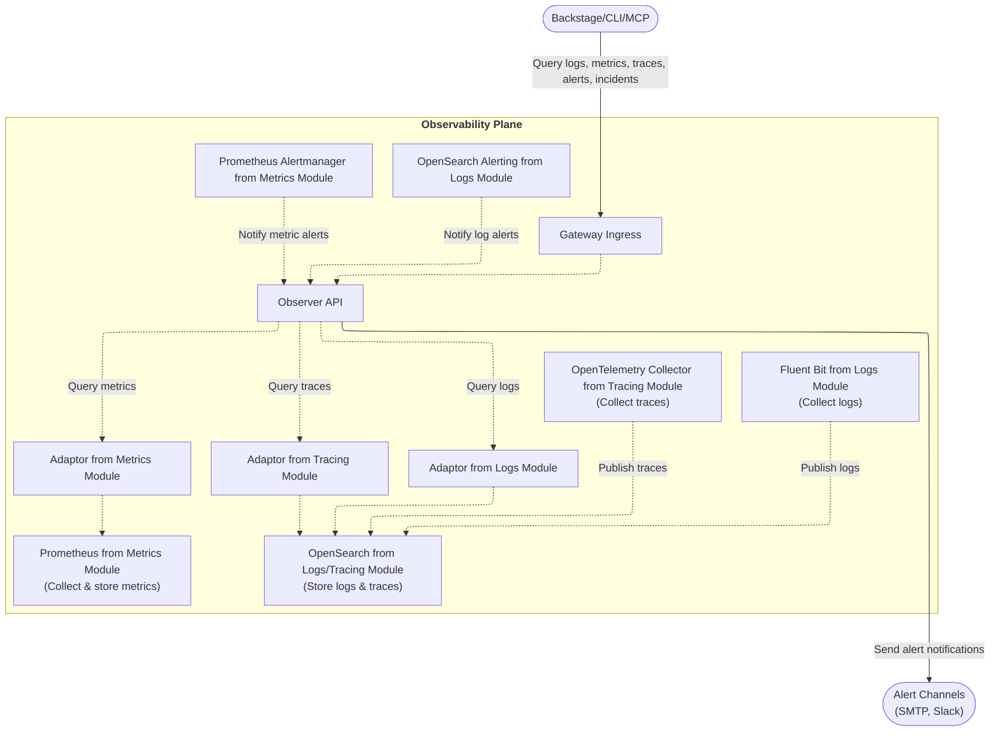
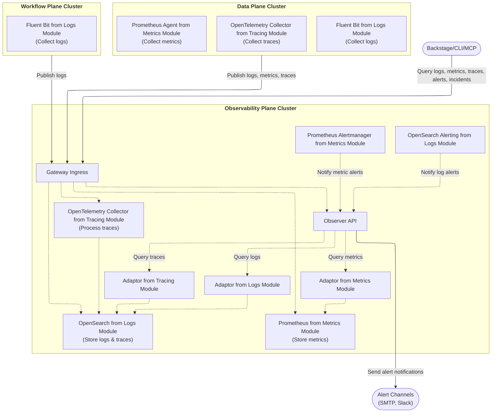

import CodeBlock from "@theme/CodeBlock";
import { versions } from "../../_constants.mdx";

# Observability

OpenChoreo provides an optional observability plane, which consists of a comprehensive observability stack
for monitoring applications deployed on the platform. The observability plane is designed in a modular architecture
so platform engineers can configure the observability plane to fit their needs, using the tools and technologies they are familiar with.

The observability plane ships a selected set of modules by default when installed,
but platform engineers can replace or supplement the default modules with any community module.

## Overview

OpenChoreo's default observability architecture consists of:

| Pillar      | Components                                                                                                                                                      |
| ----------- | --------------------------------------------------------------------------------------------------------------------------------------------------------------- |
| **Logs**    | A logs collector deployed to the data plane, and a logs storage deployed to the observability plane (defaults to observability-logs-opensearch module)          |
| **Metrics** | A metrics collector deployed to the data plane, and a metrics storage deployed to the observability plane (defaults to observability-metrics-prometheus module) |
| **Traces**  | A traces collector deployed to the data plane, and a traces storage deployed to the observability plane (defaults to observability-tracing-opensearch module)   |

All observability data is accessible through the **Observer API**, which provides a unified interface for querying logs, metrics, and traces.

[Alerting](./alerting.mdx) is a feature provided by the observability plane, which is integrated with logs and metrics modules to facilitate a unified alerting experience across the platform.

## Architecture

### Single-Cluster Setup

In single-cluster mode, all planes run in the same Kubernetes cluster.
Observability data is collected directly from the data planes and workflow plane
via the agents deployed in the observability plane.

### Multi-Cluster Setup

Multi-cluster mode is designed to run the observability plane on a dedicated cluster.
Data planes and workflow plane deploy local collectors from the respective observability modules that publish observability data
to the observability plane through the gateway ingress of the observability plane.

In this setup:

- **Data Plane** deploys Fluent Bit to collect logs, Prometheus Agent to collect metrics, and OpenTelemetry Collector to collect traces
- **Workflow Plane** deploys Fluent Bit to collect workflow run logs
- All collectors publish data through the **Gateway Ingress** in the Observability Plane
- The **Observer API** queries OpenSearch and Prometheus to serve unified observability data

For detailed multi-cluster setup instructions, see [Multi-Cluster Connectivity](../multi-cluster-connectivity.mdx).

## Prerequisites

- OpenChoreo control plane installed
- Data plane and workflow plane (optional) installed to observe
- Observability plane installed (see [Installation](#installing-the-observability-plane))

## Installing the Observability Plane

Refer to [Getting Started](../../getting-started/try-it-out/on-k3d-locally.mdx#step-7-setup-observability-plane-optional)
or [Multi-Cluster Connectivity](../multi-cluster-connectivity.mdx#observability-plane)
for instructions on installing the observability plane in single-cluster or multi-cluster mode.

## In This Section

- [Logs](./logs.mdx): collecting and querying container logs, and [platform logs](./platform-logs.mdx) by raw Kubernetes coordinates
- [Metrics](./metrics.mdx): collecting and querying resource and HTTP metrics
- [Traces](./traces.mdx): collecting and querying traces, and [sending traces](../../developer-guide/monitor-and-troubleshoot/traces.md) from components
- [Alerting](./alerting.mdx): alert rules, [notification channels](./notification-channels.mdx), AI root cause analysis and alert storage
- [Audit Logging](./audit-logging.mdx): recording who changed what on the platform, and querying the audit trail
- [Observer External IdP Configuration](./observer-external-idp.mdx): using an external identity provider for the Observer
- [Cost Insights](./cost-insights.mdx) and [Delivery Insights](./delivery-insights.mdx)

## Configuration Reference

### Key Helm Values

| Value                                      | Default | Description                                          |
| ------------------------------------------ | ------- | ---------------------------------------------------- |
| `observability-logs-opensearch.enabled`    | `false` | Enable OpenSearch based community module for logs    |
| `observability-metrics-prometheus.enabled` | `false` | Enable Prometheus based community module for metrics |
| `observability-tracing-opensearch.enabled` | `false` | Enable OpenSearch based community module for traces  |
| `rca.enabled`                              | `false` | Enable AI SRE Agent                                  |

For complete configuration options, see the [Observability Plane Helm Reference](../../reference/helm/observability-plane.mdx).

## Related Documentation

- [Deployment Topology](../deployment-topology.mdx) - Multi-plane architecture overview
- [Multi-Cluster Connectivity](../multi-cluster-connectivity.mdx) - Connecting planes across clusters
- [Observability Plane Helm Reference](../../reference/helm/observability-plane.mdx) - Complete Helm configuration options
