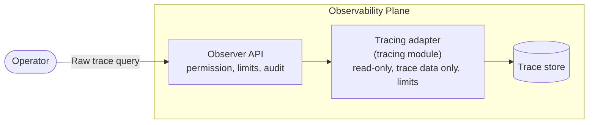

# Raw Trace Queries

Raw trace queries let platform engineers send the tracing backend's own search request, such as an OpenSearch search body, and get the backend's own response back. They answer questions the trace query API can't, such as "which traces called PostgreSQL and failed?" or "which spans took longer than two seconds?", without handing out the backend's credentials.

A raw query is not scoped to a namespace, project or component: it can read every trace the observability plane holds. It needs a dedicated, cluster-scoped permission, runs read-only within limits, and every call is audited. Developers read their components' traces in the Backstage portal, through the scoped trace query API. See [Traces](../../developer-guide/monitor-and-troubleshoot/traces.md#viewing-traces) in the Developer Guide.

## How It Works

The Observer of an observability plane forwards a raw query to the plane's tracing module, which runs it against its trace data and returns the backend's response unchanged.



The request body is the backend's native request: `application/json` for backends whose request is JSON, or `text/plain` where the query text is the whole request. For example, against the OpenSearch tracing module, error spans per service in an hour:

```http
POST /api/v1alpha1/traces/raw-query
Content-Type: application/json

{
  "size": 0,
  "query": {
    "bool": {
      "filter": [
        { "range": { "startTime": { "gte": "2026-10-20T08:00:00Z", "lte": "2026-10-20T09:00:00Z" } } },
        { "term": { "status.code": "Error" } }
      ]
    }
  },
  "aggs": {
    "by_service": { "terms": { "field": "resource.service.name", "size": 20 } }
  }
}
```

The response is exactly what the backend returned, with no envelope:

```json
{
  "took": 12,
  "timed_out": false,
  "hits": { "total": { "value": 37, "relation": "eq" }, "hits": [] },
  "aggregations": {
    "by_service": {
      "buckets": [
        { "key": "checkout", "doc_count": 21 },
        { "key": "payments", "doc_count": 16 }
      ]
    }
  }
}
```

- **The request is in the backend's format.** The request doesn't name the backend: each tracing module takes one kind of request. A request the backend can't parse or rejects gets `400`, and the message says what the module expects. A body in a media type the module doesn't take gets `415`.
- **The time range is part of the request**, in the backend's syntax, such as a `range` filter in an OpenSearch search body. Without one, a query reads everything the backend holds for traces, still bounded by the timeout and the maximum response size.
- **The request sets its own row limit** in the backend's syntax, such as `size` in an OpenSearch search body. The backend's own limits still apply underneath, such as OpenSearch's maximum result window.
- **The module owns the fields that set limits.** It overrides them, such as the search timeout, so a request can't extend them.
- **A result is never partial.** A result larger than the maximum response size is rejected, and a query that runs past the timeout gets `504`.
- **A query stops with its caller.** If the caller disconnects or gives up, the Observer cancels its request to the tracing module, and the module cancels its request to the backend. Some backends finish a search already running regardless, still bounded by the timeout; the module's README says which.

## Prerequisites

- An observability plane installed and registered as a `ClusterObservabilityPlane` or `ObservabilityPlane`.
- A tracing module that supports raw queries, set up as its README describes. Each module's README lists raw trace queries under **Features**, with the module version and setup they need. A module without raw query support answers with `501 Not Implemented`.

## Access to Raw Trace Queries

Running a raw trace query requires the **`traces:rawquery`** action, evaluated at **cluster scope**. A namespace- or project-scoped role binding never grants it.

Of the default roles, `admin` and `platform-engineer` include it. `developer`, `sre` and the RCA agent don't.

:::warning
`traces:rawquery` reads traces with no ownership check. A raw query can read **every trace the observability plane holds**, including the span attributes of every component in every project. Grant it only to roles that already have platform-wide access.
:::

To grant it on its own, bind a `ClusterAuthzRole` that contains the action:

```yaml
apiVersion: openchoreo.dev/v1alpha1
kind: ClusterAuthzRole
metadata:
  name: raw-trace-query
spec:
  actions:
    - "traces:rawquery"
```

See [Custom Roles and Bindings](../authorization/custom-roles.mdx) to bind it to a group.

## Request Bodies

Each tracing module takes its backend's own request, and its README documents what the module accepts, which requests it rejects and how to set it up. For example, the [OpenSearch tracing module](https://github.com/openchoreo/community-modules/tree/main/observability-tracing-opensearch#raw-trace-queries) takes an OpenSearch search body, sent as `application/json`, and runs it against the trace indices only, as a read-only OpenSearch user.

## Limits

| Limit                         | Default | Observability plane chart                            | Tracing module chart                |
| ----------------------------- | ------- | ---------------------------------------------------- | ----------------------------------- |
| Query timeout                 | `30s`   | `observer.tracingAdapter.rawQuery.timeout`           | `adapter.rawQuery.timeout`          |
| Maximum request size          | 1 MiB   | `observer.tracingAdapter.rawQuery.maxRequestBytes`   | —                                   |
| Maximum response size         | 10 MiB  | `observer.tracingAdapter.rawQuery.maxResponseBytes`  | `adapter.rawQuery.maxResponseBytes` |
| Queries running at once       | 4       | `observer.tracingAdapter.rawQuery.maxConcurrent`     | —                                   |
| Queries per caller per minute | 10      | `observer.tracingAdapter.rawQuery.requestsPerMinute` | —                                   |
| Burst per caller              | 5       | `observer.tracingAdapter.rawQuery.burst`             | —                                   |

The Observer rejects a larger request body before forwarding it. The tracing module stops the query at its own timeout and rejects a larger result. Keep the Observer's and the module's values in line: the Observer waits a few seconds longer than its timeout for the module to answer.

A query over the concurrency or per-caller limit gets `429 Too Many Requests` with a `Retry-After` header, in seconds, saying when to try again. A caller may start up to the burst at once, then queries at the per-minute rate. Queries count against the per-caller limit when they start, including ones the backend then rejects. Setting `maxConcurrent` or `requestsPerMinute` to `0` turns that limit off.

:::note
The concurrency and per-caller limits apply **per Observer replica**. With several replicas, the platform-wide limits are the values multiplied by the replica count, so divide the values you want by the replica count when setting them.
:::

There is no time window limit: the time range is part of the request. On cloud backends that charge per data scanned, a query without a time range can be costly.

## Audit

With [audit logging](./audit-logging.mdx) enabled on the observability plane, every raw trace query is recorded and published by default, unlike other trace reads, because a raw query reads traces outside any scope. The record holds the caller, the outcome (successful, denied or failed), the request's media type and the request body. The result itself is never recorded. Long requests are recorded in part.

## Errors

| Situation                                                                     | Response | Error code    |
| ----------------------------------------------------------------------------- | -------- | ------------- |
| An empty or malformed request body                                            | `400`    | `OBS-V1-T-06` |
| A request the backend rejects, saying what the module expects                 | `400`    | `OBS-V1-T-12` |
| A result larger than the Observer's maximum response size                     | `400`    | `OBS-V1-T-11` |
| The caller lacks `traces:rawquery`                                            | `403`    |               |
| A request body larger than the maximum request size                           | `413`    | `OBS-V1-T-13` |
| A request body in a media type the Observer or the module doesn't take        | `415`    | `OBS-V1-T-14` |
| Too many raw queries running at once                                          | `429`    | `OBS-V1-T-15` |
| Too many raw queries from the caller                                          | `429`    | `OBS-V1-T-16` |
| The plane's tracing module doesn't support raw queries                        | `501`    | `OBS-V1-T-09` |
| The query ran past the timeout, or the backend returned only a partial result | `504`    | `OBS-V1-T-10` |

## Running Raw Queries

Raw trace queries are available through the Observer REST API: `POST /api/v1alpha1/traces/raw-query`. The Backstage portal, `occ` and the MCP server don't offer them yet.
