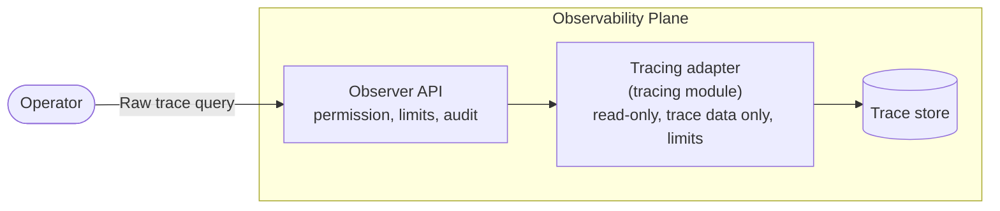

# Raw Trace Queries

Raw trace queries let platform engineers send the tracing backend's own search request, such as an OpenSearch search body or an OpenObserve search body, and get the backend's own response back. They answer questions the trace query API can't, such as "which traces called PostgreSQL and failed?" or "which spans took longer than two seconds?", without handing out the backend's credentials.

A raw query is not scoped to a namespace, project or component: it can read every trace the observability plane holds. It needs a dedicated, cluster-scoped permission, runs read-only within limits, and every call is audited. Developers read their components' traces from the component pages, through the scoped trace query API.

## How It Works

The Observer of an observability plane forwards a raw query to the plane's tracing module, which runs it against its trace data and returns the backend's response unchanged.



The request body is the backend's native request: `application/json` for backends whose request is JSON, or `text/plain` where the query text is the whole request. For example, against the OpenObserve module:

```http
POST /api/v1alpha1/traces/raw-query
Content-Type: application/json

{
  "query": {
    "sql": "SELECT trace_id, operation_name, duration FROM \"default\" WHERE span_status = 'ERROR' ORDER BY duration DESC LIMIT 10",
    "start_time": 1792483200000000,
    "end_time": 1792486800000000
  }
}
```

The response is exactly what the backend returned, with no envelope:

```json
{
  "took": 42,
  "hits": [{ "trace_id": "…", "operation_name": "…", "duration": 5767 }],
  "total": 1
}
```

- **The request is in the backend's format.** The request doesn't name the backend: each tracing module takes one kind of request. A request the backend can't parse or rejects gets `400`, and the message says what the module expects. A body in a media type the module doesn't take gets `415`.
- **The time range is part of the request**, in the backend's syntax: a `range` filter in an OpenSearch search body, or `start_time`/`end_time` in an OpenObserve search body. Without one, a query reads everything the backend holds for traces, still bounded by the timeout and the maximum response size.
- **The request sets its own row limit** in the backend's syntax (`size` in an OpenSearch search body, `LIMIT` in SQL). The backends' own limits still apply underneath, such as OpenSearch's maximum result window.
- **The module owns the fields that set limits.** It overrides them, such as the search timeout, so a request can't extend them.
- **A result is never partial.** A result larger than the maximum response size is rejected, and a query that runs past the timeout gets `504`.

## Prerequisites

- An observability plane installed and registered as a `ClusterObservabilityPlane` or `ObservabilityPlane`.
- A tracing module that supports raw queries:

  | Module                                                                                                                           | Request body                                | Minimum version |
  | -------------------------------------------------------------------------------------------------------------------------------- | ------------------------------------------- | --------------- |
  | [observability-tracing-opensearch](https://github.com/openchoreo/community-modules/tree/main/observability-tracing-opensearch)   | OpenSearch search body, `application/json`  | 0.10.0          |
  | [observability-tracing-openobserve](https://github.com/openchoreo/community-modules/tree/main/observability-tracing-openobserve) | OpenObserve search body, `application/json` | 0.4.0           |

  A module without raw query support, including an older version of the modules above, answers with `501 Not Implemented`.

## Access to Raw Trace Queries

Running a raw trace query requires the **`traces:rawquery`** action, evaluated at **cluster scope**. A namespace- or project-scoped role binding never grants it.

Of the default roles, `admin` and `platform-engineer` include it. `developer`, `sre` and the RCA agent don't.

:::warning
`traces:rawquery` reads traces with no ownership check. A raw query can read **every trace the observability plane holds**, including the span attributes of every component in every project. Grant it only to roles that already have platform-wide access.
:::

To grant it on its own, bind a `ClusterAuthzRole` that contains the action:

```yaml
apiVersion: openchoreo.dev/v1alpha1
kind: ClusterAuthzRole
metadata:
  name: raw-trace-query
spec:
  actions:
    - "traces:rawquery"
```

See [Custom Roles and Bindings](./authorization/custom-roles.mdx) to bind it to a group.

## Request Bodies

### OpenSearch

The body is an OpenSearch search body (`query`, `size`, `aggs`, `sort`, `collapse` and so on), sent as `application/json`. The response is OpenSearch's search response. For example, error spans per service in an hour:

```json
{
  "size": 0,
  "query": {
    "bool": {
      "filter": [
        {
          "range": {
            "startTime": {
              "gte": "2026-10-20T08:00:00Z",
              "lte": "2026-10-20T09:00:00Z"
            }
          }
        },
        { "term": { "status.code": "Error" } }
      ]
    }
  },
  "aggs": {
    "by_service": { "terms": { "field": "resource.service.name", "size": 20 } }
  }
}
```

- The body runs against the trace indices (`otel-traces-*`), as a read-only OpenSearch user whose role can only read those indices. The module's chart generates the user's credentials, and its setup job creates the user and role; see the module's README to use credentials of your own.
- Bodies that read other indices (terms lookups, `more_like_this` documents, indexed shapes, percolate) are rejected, and so are `global` aggregations.
- **Span attributes must be mapped to be searchable.** The trace index template maps only the fields the adapter itself queries, such as timestamps, IDs, span status and resource attributes. Span attributes are stored but can't be matched until they are mapped. Add mappings with the module's `openSearchSetup.traceIndexMappings` value:

  ```yaml
  openSearchSetup:
    traceIndexMappings:
      attributes.db.system.name: { type: keyword }
      attributes.http.route: { type: keyword }
  ```

  The setup job adds them to the index template and to the existing trace indices. Spans stored before a field was mapped become searchable on it once reindexed.

### OpenObserve

The body is an OpenObserve search body, sent as `application/json`, with the SQL in `query.sql`. OpenObserve requires `start_time` and `end_time`, in microseconds. Span attributes are columns, with `.` in their names replaced by `_`. The response is OpenObserve's search response. For example, failed PostgreSQL calls in an hour:

```json
{
  "query": {
    "sql": "SELECT trace_id, operation_name, duration FROM \"default\" WHERE db_system_name = 'postgresql' AND span_status = 'ERROR' ORDER BY duration DESC LIMIT 50",
    "start_time": 1792483200000000,
    "end_time": 1792486800000000
  }
}
```

The body runs through OpenObserve's search API for traces, in the module's organization, so it can read trace streams and nothing else. Every trace stream in that organization is reachable, not only the configured one.

## Limits

| Limit                 | Default | Observability plane chart                           | Tracing module chart                |
| --------------------- | ------- | --------------------------------------------------- | ----------------------------------- |
| Query timeout         | `30s`   | `observer.tracingAdapter.rawQuery.timeout`          | `adapter.rawQuery.timeout`          |
| Maximum request size  | 1 MiB   | `observer.tracingAdapter.rawQuery.maxRequestBytes`  | —                                   |
| Maximum response size | 10 MiB  | `observer.tracingAdapter.rawQuery.maxResponseBytes` | `adapter.rawQuery.maxResponseBytes` |

The Observer rejects a larger request body before forwarding it. The tracing module stops the query at its own timeout and rejects a larger result. Keep the Observer's and the module's values in line: the Observer waits a few seconds longer than its timeout for the module to answer.

There is no time window limit: the time range is part of the request. On cloud backends that charge per data scanned, a query without a time range can be costly.

## Audit

With [audit logging](./audit-logging.mdx) enabled on the observability plane, every raw trace query is recorded and published by default, unlike other trace reads, because a raw query reads traces outside any scope. The record holds the caller, the outcome (successful, denied or failed), the request's media type and the request body. The result itself is never recorded. Long requests are recorded in part.

## Errors

| Situation                                                                     | Response | Error code    |
| ----------------------------------------------------------------------------- | -------- | ------------- |
| An empty or malformed request body                                            | `400`    | `OBS-V1-T-06` |
| A request the backend rejects, saying what the module expects                 | `400`    | `OBS-V1-T-12` |
| A result larger than the Observer's maximum response size                     | `400`    | `OBS-V1-T-11` |
| The caller lacks `traces:rawquery`                                            | `403`    |               |
| A request body larger than the maximum request size                           | `413`    | `OBS-V1-T-13` |
| A request body in a media type the Observer or the module doesn't take        | `415`    | `OBS-V1-T-14` |
| The plane's tracing module doesn't support raw queries                        | `501`    | `OBS-V1-T-09` |
| The query ran past the timeout, or the backend returned only a partial result | `504`    | `OBS-V1-T-10` |

## Running Raw Queries

Raw trace queries are available through the Observer REST API: `POST /api/v1alpha1/traces/raw-query`. The Backstage portal, `occ` and the MCP server don't offer them yet.
